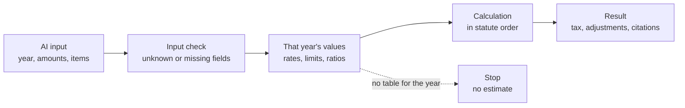

# korean-tax-calc-mcp — Korea Tax Calculator MCP

<!-- mcp-name: io.github.UpstageAI/korean-tax-calc-mcp -->


[](https://pypi.org/project/korean-tax-calc-mcp/) [](https://registry.modelcontextprotocol.io/v0/servers?search=korean-tax-calc-mcp) [](LICENSE) [](https://www.upstage.ai/) · [한국어](README.md)

> **Code has been written by Solar Pro 4 since 0.3.0**, reviewed by CodeSolar and cross-checked with tests by Claude. The 0.13.0 audit and fixes (year-by-year statute and addenda checks) were done by Claude. 91 tools — see [CHANGELOG](CHANGELOG.md).

**Korean tax calculations for AI agents — code, not guesses.** [한국어](README.md)

## How it works



1. **Input check** — unknown or missing fields stop the calculation with a list of what to provide.
2. **That year's values** — rates and limits come from year tables in the code (corporate and income tax 2016–2026, VAT 2016-1 to 2026-2); item-level criteria come from `facts_vocab.json` with effective periods and statute references.
3. **Calculation** — follows the statute order, e.g. tax base → that year's brackets → tax.
4. **Result** — tax, intermediate amounts, item-level judgments, adjustments with income dispositions, and citations.

The 82 calculation and judgment tools run on your PC without generative AI. Only the 3 PDF tools use Upstage, and only when `UPSTAGE_API_KEY` is set.

## Try asking

- "Corporate tax on a 500M KRW tax base for fiscal year 2025?"
- "Shareholder loan of 200M on Mar 1, 100M repaid Sep 30 — deemed interest?"
- "Under-reported 10M KRW of tax, paying on Oct 7 — what are the penalties?"
- "Retirement income tax on 100M KRW after 15 years of service"
- "Here are five entertainment-expense ledger lines — give me the FY2025 adjustments"

## Install

```bash
claude mcp add korean-tax-calc -- uvx korean-tax-calc-mcp
```

```json
{
  "mcpServers": {
    "korean-tax-calc": { "command": "uvx", "args": ["korean-tax-calc-mcp"] },
    "korean-tax":      { "command": "uvx", "args": ["korean-tax-mcp"], "env": { "LAW_OC": "law.go.kr OC (free, optional)" } }
  }
}
```

The second entry, [korean-tax-mcp](https://github.com/UpstageAI/korean-tax-mcp), is the companion server for statutes, addenda, rulings and cases. With both installed, "find the basis → compute → fill the form" runs in one conversation, and this server's `find_tool` returns ready-to-call statute lookups for questions it has no calculator for (rent tax credit, pension-account credit, stock gains …). The first line alone is enough if you only need calculations.

To pick up a new release right away: `uvx --refresh korean-tax-calc-mcp` (uvx caches the downloaded version). Pin with `uvx korean-tax-calc-mcp@0.16.0`.

No key needed. Optional: `LAW_OC` (law.go.kr lookups in two audit tools), `UPSTAGE_API_KEY` (PDF table extraction).

## Tools (85)

| Group | Tools |
|---|---|
| Corporate tax (18) | tax `corporate_tax` · foreign tax credit `foreign_tax_credit` · entertainment limit `entertainment_limit` · deemed interest `deemed_interest` · unfair transaction test `unfair_transaction` · loss carryforward limit `loss_carryforward_limit` · minimum tax `minimum_tax` · non-business interest (advance exclusions, day-balances, ordering) `nonbusiness_interest_disallowance` · company cars `business_car_expense` · donation limit `donation_limit` · bad debt allowance `bad_debt_allowance` · thin capitalization `thin_capitalization` · missing receipts `missing_receipt_disallowance` · dividends received deduction `dividend_received_deduction` · asset grant reserve `asset_grant_reserve` · deemed rent income on deposits `corporate_deemed_rent_income` · liquidation income `liquidation_income` · disaster loss credit `disaster_loss_credit` |
| Income, withholding, transfer, inheritance (23) | income tax `income_tax` · withholding `withholding_tax` · non-resident withholding `nonresident_withholding` · retirement income `retirement_income_tax` · wage income `wage_income_tax` · daily workers `daily_worker_withholding` · deemed bonus resettlement `deemed_bonus_resettlement` · special tax credit `special_tax_credit` · capital gains `capital_gains_income` · inheritance tax `inheritance_tax` · gift tax `gift_tax` · estimated business income `estimated_business_income` · personal deductions `personal_deduction` · pension income `pension_income` · loss offset `income_loss_offset` · pension account withdrawal `pension_account_withdrawal` · inheritance/gift valuation `inheritance_gift_valuation` · capital gains tax `capital_gains_tax` · housing deemed rent `housing_deemed_rent_income` · housing rental income `housing_rental_income` · child tax credit `child_tax_credit` · dividend tax credit `dividend_tax_credit` · religious income `religious_income` |
| VAT, penalties, limitation (14) | deemed rent `vat_deemed_rent` · deemed input credit `vat_deemed_input_credit` · common input allocation `vat_common_input_allocation` · simplified taxpayer `vat_simplified_taxpayer` · card sales credit `vat_card_sales_credit` · bad debt credit `vat_bad_debt_credit` · under-reporting penalty `underreporting_penalty` · late payment penalty `late_payment_penalty` · invoice penalty `invoice_penalty` · assessment period `assessment_limitation` · exempt-use deemed supply `vat_exempt_use_deemed_supply` · input tax deduction check `vat_input_tax_deduction` · deemed supply check `vat_deemed_supply_items` · supply timing `vat_supply_timing` |
| Facts and ledgers → tax adjustments (15) | bad debts `bad_debt_adjustment` · entertainment `entertainment_adjustment` · bonus-share deemed dividend `deemed_dividend_bonus_shares` · financial income `financial_income_aggregate` · other income `other_income_aggregate` · employment gross pay `earned_income_gross_pay` · simplified VAT return `simplified_vat_return` · common input tax `common_input_tax` · input tax recalculation `input_tax_recalculation` · land/building split `bundled_supply_split` · depreciation `depreciation_adjustment` · retirement allowance `retirement_allowance_adjustment` · capital-reduction deemed dividend `deemed_dividend_capital_reduction` · inventory valuation `inventory_valuation_adjustment` · adjusted income total `income_adjustment_total` |
| Tax audit checks (9) | related parties (incl. relatives sharing livelihood) `related_judge` · kinship `kinship_check` · indirect ownership `ownership_ratio` · dominant shareholder `dominant_shareholder` · tunnelling gift `tunnelling_gift` · tunnelling gift (NTS formula) `tunnelling_gift_nts` · related-party article location `related_provision_at` · return pre-check `return_precheck` · pre-check input schema `precheck_schema` |
| PDF table extraction (3) | relations `extract_relations` · tunnelling materials `tunnelling_from_pdf` · corporate tax return `return_precheck_pdf` |
| Tax collection (1) | national tax priority distribution `tax_priority_distribution` |
| Excel export (1) | calculation workbook `export_workbook` |
| Tool finder (1) | find the right tool in plain words `find_tool` |

- **Ledger input**: adjustment tools take ledger lines as written (name, amount, receipt, nature) and return item judgments, adjustments and income dispositions.
- **Issue flags**: non-resident withholding and thin capitalization results list points that may be disputed and what to check (no conclusion).
- **Years**: corporate tax FY2016–2026, income tax 2016–2026, VAT 2016-1 to 2026-2; penalties and limitation periods follow current law. Other years stop with an error. Local income tax is separate.

## Disclaimers and notices

- **Disclaimer:** Results are a review aid, not tax advice. Verify statutes and rulings with a tax accountant, CPA or attorney before filing, during a tax audit, or in appeals. Check the statute text and case law in the original source.
- **Not a tax agent service:** This tool does not perform **tax agent services under Article 2 of the Certified Tax Accountant Act** (preparing tax adjustment statements, filing on behalf of a taxpayer, tax consultation); only certified tax accountants and registered CPAs or attorneys may do so (Article 20). It is software that turns statutory formulas into code and shows the computation for the inputs given; please verify the facts and make the final judgment together with a tax professional (tax accountant, CPA or attorney).
- **AI use notice:** The 82 computation/judgment tools run in code and do not use generative AI. The 3 PDF review tools (`extract_relations`, `tunnelling_from_pdf`, `return_precheck_pdf`) use generative AI (Upstage Solar Pro 4) when UPSTAGE_API_KEY is set, and mark that fact in their results. Without a key, they use pypdf for local text extraction (host_ai mode) and provide 정리 안내 (cleanup guidance) so the next tool input can be prepared manually.
- **Data transmission:** Document content is sent to the Upstage API (api.upstage.ai) only when UPSTAGE_API_KEY is set and the PDF tools are used. Without a key (pypdf local extraction), no data is transmitted externally. Do not submit documents containing personal or sensitive information when using the API-based flow.

## License

MIT © 2026 Upstage · Created by Mia (Seungmi Yoon)
