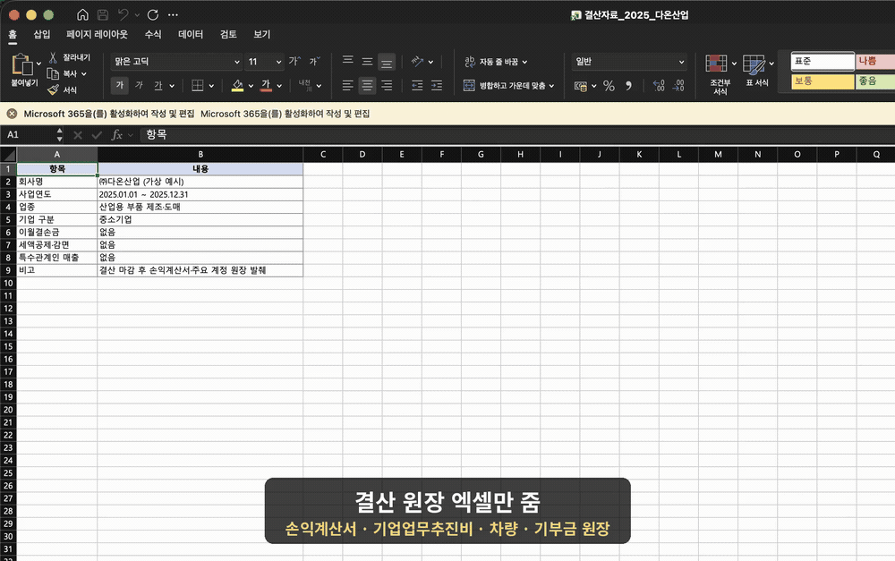
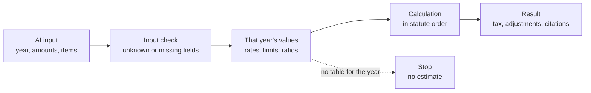
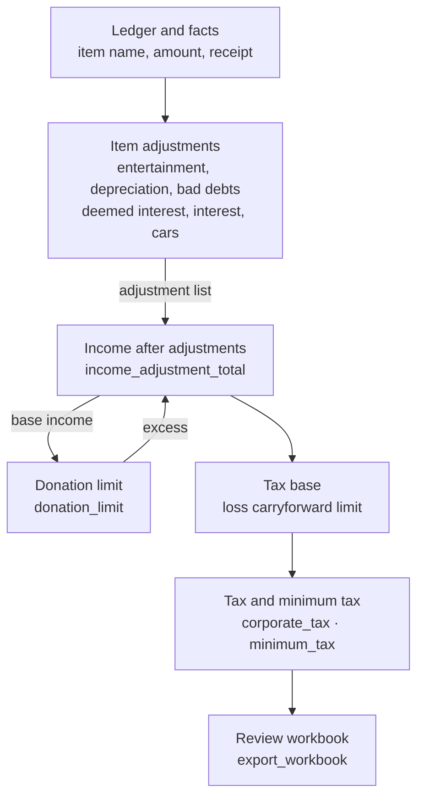

# korean-tax-calc-mcp — Korea Tax Calculator MCP

<!-- mcp-name: io.github.UpstageAI/korean-tax-calc-mcp -->



[](https://pypi.org/project/korean-tax-calc-mcp/) [](https://registry.modelcontextprotocol.io/v0/servers?search=korean-tax-calc-mcp) [](LICENSE) [](https://www.upstage.ai/) · [한국어](README.md)

> **Authorship notice:** Versions 0.3.0–0.12.2 (2026-10-10 to 10-26) were written by **Solar Pro 4** (Solar Work CLI), reviewed by CodeSolar and cross-checked with tests by Claude (parts of 0.8.0 and all of 0.9.2 were fixed/written by Claude). **From 0.13.0 (2026-10-28) on, the existing calculator skeleton remains Solar Pro 4's, while new tools, year-by-year statute checks and bug fixes are written by Claude (Anthropic)** and reviewed by CodeSolar. Each [CHANGELOG](CHANGELOG.md) section states who wrote it. 95 tools.

**Korean tax calculations for AI agents — code, not guesses.** [한국어](README.md)

## How it works



1. **Input check** — unknown or missing fields stop the calculation with a list of what to provide.
2. **That year's values** — rates and limits come from year tables in the code (corporate and income tax 2016–2026, VAT 2016-1 to 2026-2); item-level criteria come from `facts_vocab.json` with effective periods and statute references.
3. **Calculation** — follows the statute order, e.g. tax base → that year's brackets → tax.
4. **Result** — tax, intermediate amounts, item-level judgments, adjustments with income dispositions, and citations.

92 of the 95 tools run in code without generative AI (the 2 price lookups only fetch public data from KRX and VWORLD). Only the 3 PDF tools use Upstage, and only when `UPSTAGE_API_KEY` is set.

### How corporate tax adjustments chain

Tools can be used one at a time, but for corporate tax each tool's result feeds the next.



Item adjustment tools return the income disposition as well, and `export_workbook` re-runs the same calls to build a workbook whose statutory forms are linked by formulas. If you do not know which tool to use, ask `find_tool` in plain words.

## Try asking

- "Corporate tax on a 500M KRW tax base for fiscal year 2025?"
- "Shareholder loan of 200M on Mar 1, 100M repaid Sep 30 — deemed interest?"
- "Under-reported 10M KRW of tax, paying on Oct 7 — what are the penalties?"
- "Retirement income tax on 100M KRW after 15 years of service"
- "Here are five entertainment-expense ledger lines — give me the FY2025 adjustments"

## Install

```bash
claude mcp add korean-tax-calc -- uvx korean-tax-calc-mcp
```

```json
{
  "mcpServers": {
    "korean-tax-calc": { "command": "uvx", "args": ["korean-tax-calc-mcp"] },
    "korean-tax":      { "command": "uvx", "args": ["korean-tax-mcp"], "env": { "LAW_OC": "law.go.kr OC (free, optional)" } }
  }
}
```

The second entry, [korean-tax-mcp](https://github.com/UpstageAI/korean-tax-mcp), is the companion server for statutes, addenda, rulings and cases. With both installed, "find the basis → compute → fill the form" runs in one conversation, and this server's `find_tool` returns ready-to-call statute lookups for questions it has no calculator for (rent tax credit, pension-account credit, stock gains …). The first line alone is enough if you only need calculations.

To pick up a new release right away: `uvx --refresh korean-tax-calc-mcp` (uvx caches the downloaded version). Pin with `uvx korean-tax-calc-mcp@0.19.1`.

No key needed. Optional: `LAW_OC` (law.go.kr lookups in two audit tools), `UPSTAGE_API_KEY` (PDF table extraction).

## Recommended system prompt

Five rules that tell the AI when to call the tools and when to trust their answers. The server instructions carry the same rules, but some clients weight them lightly or ignore them. Adding the block below to your system prompt (Claude Desktop project instructions, Claude Code `CLAUDE.md`, or other custom instructions) makes the AI follow them more closely.

```text
When answering Korean tax questions, use korean-tax-mcp and korean-tax-calc-mcp as follows.
1. For every amount and every judgment, first check whether a tool exists. If you do not know the name, use find_tool; for timing of income or supply, check timing_rules first.
2. If a tool exists, call it before calculating by hand.
3. If the tool result differs from your own calculation, do not pick one right away. Recheck the inputs, open the deciding provision with law_article, and match its requirements to the facts one by one.
4. If no provision shows the tool is wrong, use the tool result. If you use a different value, state the reason (input error or article number) in one line.
5. If two values come out (before/after apportionment, total vs. taxable part, etc.), answer only the one the question asks for.
```

## Tools (95)

Click a group to expand its tools.

<details>
<summary><b>Corporate tax</b> (18)</summary>

| Tool | What it does |
|---|---|
| `corporate_tax` | tax |
| `foreign_tax_credit` | foreign tax credit |
| `entertainment_limit` | entertainment limit |
| `deemed_interest` | deemed interest |
| `unfair_transaction` | unfair transaction test |
| `loss_carryforward_limit` | loss carryforward limit |
| `minimum_tax` | minimum tax |
| `nonbusiness_interest_disallowance` | non-business interest (advance exclusions, day-balances, ordering) |
| `business_car_expense` | company cars |
| `donation_limit` | donation limit |
| `bad_debt_allowance` | bad debt allowance |
| `thin_capitalization` | thin capitalization |
| `missing_receipt_disallowance` | missing receipts |
| `dividend_received_deduction` | dividends received deduction |
| `asset_grant_reserve` | asset grant reserve |
| `corporate_deemed_rent_income` | deemed rent income on deposits |
| `liquidation_income` | liquidation income |
| `disaster_loss_credit` | disaster loss credit |

</details>
<details>
<summary><b>Income, withholding, transfer, inheritance</b> (24)</summary>

| Tool | What it does |
|---|---|
| `income_tax` | income tax |
| `withholding_tax` | withholding |
| `nonresident_withholding` | non-resident withholding |
| `retirement_income_tax` | retirement income |
| `wage_income_tax` | wage income |
| `daily_worker_withholding` | daily workers |
| `deemed_bonus_resettlement` | deemed bonus resettlement |
| `special_tax_credit` | special tax credit |
| `capital_gains_income` | capital gains |
| `inheritance_tax` | inheritance tax |
| `gift_tax` | gift tax |
| `estimated_business_income` | estimated business income |
| `personal_deduction` | personal deductions |
| `pension_income` | pension income |
| `income_loss_offset` | loss offset |
| `pension_account_withdrawal` | pension account withdrawal |
| `inheritance_gift_valuation` | inheritance/gift valuation |
| `capital_gains_tax` | capital gains tax |
| `housing_deemed_rent_income` | housing deemed rent |
| `housing_rental_income` | housing rental income |
| `child_tax_credit` | child tax credit |
| `dividend_tax_credit` | dividend tax credit |
| `religious_income` | religious income |
| `individual_donation_expense` | donation expense limit for sole proprietors |

</details>
<details>
<summary><b>VAT, penalties, limitation, refund claims</b> (16)</summary>

| Tool | What it does |
|---|---|
| `vat_deemed_rent` | deemed rent |
| `vat_deemed_input_credit` | deemed input credit |
| `vat_common_input_allocation` | common input allocation |
| `vat_simplified_taxpayer` | simplified taxpayer |
| `vat_card_sales_credit` | card sales credit |
| `vat_bad_debt_credit` | bad debt credit (added back to output tax on recovery) |
| `underreporting_penalty` | under-reporting penalty |
| `late_payment_penalty` | late payment penalty |
| `withholding_late_payment_penalty` | withholding tax late-payment penalty (Framework Act Art. 47-5: 3% + daily, capped) |
| `invoice_penalty` | invoice penalty |
| `assessment_limitation` | assessment period |
| `refund_claim_deadline` | refund claim (경정청구) deadline — ordinary 5 years, subsequent-event 3 months, increased-assessment 3 months; weekend/holiday rule applied |
| `vat_exempt_use_deemed_supply` | exempt-use deemed supply |
| `vat_input_tax_deduction` | input tax deduction check |
| `vat_deemed_supply_items` | deemed supply check |
| `vat_supply_timing` | supply timing |

</details>
<details>
<summary><b>Facts and ledgers → tax adjustments</b> (15)</summary>

| Tool | What it does |
|---|---|
| `bad_debt_adjustment` | bad debts |
| `entertainment_adjustment` | entertainment |
| `deemed_dividend_bonus_shares` | bonus-share deemed dividend |
| `financial_income_aggregate` | financial income |
| `other_income_aggregate` | other income |
| `earned_income_gross_pay` | employment gross pay |
| `simplified_vat_return` | simplified VAT return |
| `common_input_tax` | common input tax |
| `input_tax_recalculation` | input tax recalculation |
| `bundled_supply_split` | land/building split |
| `depreciation_adjustment` | depreciation |
| `retirement_allowance_adjustment` | retirement allowance |
| `deemed_dividend_capital_reduction` | capital-reduction deemed dividend |
| `inventory_valuation_adjustment` | inventory valuation |
| `income_adjustment_total` | adjusted income total |

</details>
<details>
<summary><b>Shares and property valuation</b> (7)</summary>

| Tool | What it does |
|---|---|
| `stock_major_shareholder` | major-shareholder test for share transfers (shareholder register, aggregation) |
| `stock_capital_gains_tax` | capital gains tax on shares (taxability, rates, filing deadline) |
| `unlisted_stock_valuation` | unlisted share valuation for inheritance/gift (earnings/net-asset weighting, premium) |
| `stock_basis_income_tax` | unlisted share standard price under the Income Tax Act |
| `building_standard_price` | building standard price (NTS formula) |
| `stock_price_lookup` | listed share price lookup (KRX) |
| `official_property_price` | official land/housing price lookup (VWORLD, VWORLD_KEY) |

</details>
<details>
<summary><b>Tax audit checks</b> (9)</summary>

| Tool | What it does |
|---|---|
| `related_judge` | related parties (incl. relatives sharing livelihood) |
| `kinship_check` | kinship |
| `ownership_ratio` | indirect ownership |
| `dominant_shareholder` | dominant shareholder |
| `tunnelling_gift` | tunnelling gift |
| `tunnelling_gift_nts` | tunnelling gift (NTS formula) |
| `related_provision_at` | related-party article location |
| `return_precheck` | return pre-check |
| `precheck_schema` | pre-check input schema |

</details>
<details>
<summary><b>PDF table extraction</b> (3)</summary>

| Tool | What it does |
|---|---|
| `extract_relations` | relations |
| `tunnelling_from_pdf` | tunnelling materials |
| `return_precheck_pdf` | corporate tax return |

</details>
<details>
<summary><b>Tax collection</b> (1)</summary>

| Tool | What it does |
|---|---|
| `tax_priority_distribution` | national tax priority distribution |

</details>
<details>
<summary><b>Excel export</b> (1)</summary>

| Tool | What it does |
|---|---|
| `export_workbook` | calculation workbook |

</details>
<details>
<summary><b>Tool finder</b> (1)</summary>

| Tool | What it does |
|---|---|
| `find_tool` | find the right tool in plain words |

</details>

- **Excel export**: `export_workbook` re-runs several tool calls and produces a review workbook shaped like the statutory forms (Article 3, Article 15, Article 23 (a)/(b), Article 32, Article 33, Article 34, Article 20(1), Article 16-2, Article 26 (a)/(b), Article 50(b); VAT input-tax-not-deductible statement; global-income-tax supplementary statements; capital-gains-tax Article 84 return tax computation and Appendix 1 capital-gains computation statement; etc.).
- **Ledger input**: adjustment tools take ledger lines as written (name, amount, receipt, nature) and return item judgments, adjustments and income dispositions.
- **Issue flags**: non-resident withholding and thin capitalization results list points that may be disputed and what to check (no conclusion).
- **Years**: corporate tax FY2016–2026, income tax 2016–2026, VAT 2016-1 to 2026-2; penalties and limitation periods follow current law. Other years stop with an error. Local income tax is separate.

## Disclaimers and notices

- **Disclaimer:** Results are a review aid, not tax advice. Verify statutes and rulings with a tax accountant, CPA or attorney before filing, during a tax audit, or in appeals. Check the statute text and case law in the original source.
- **Not a tax agent service:** This tool does not perform **tax agent services under Article 2 of the Certified Tax Accountant Act** (preparing tax adjustment statements, filing on behalf of a taxpayer, tax consultation); only certified tax accountants and registered CPAs or attorneys may do so (Article 20). It is software that turns statutory formulas into code and shows the computation for the inputs given; please verify the facts and make the final judgment together with a tax professional (tax accountant, CPA or attorney).
- **AI use notice:** The 92 computation, judgment and lookup tools run in code and do not use generative AI. The 3 PDF review tools (`extract_relations`, `tunnelling_from_pdf`, `return_precheck_pdf`) use generative AI (Upstage Solar Pro 4) when UPSTAGE_API_KEY is set, and mark that fact in their results. Without a key, they use pypdf for local text extraction (host_ai mode) and provide 정리 안내 (cleanup guidance) so the next tool input can be prepared manually.
- **Data transmission:** Document content is sent to the Upstage API (api.upstage.ai) only when UPSTAGE_API_KEY is set and the PDF tools are used. The price lookups send only a ticker and date to KRX (`stock_price_lookup`) or an address, parcel number and year to VWORLD (`official_property_price`, needs VWORLD_KEY). Without a key (pypdf local extraction), no data is transmitted externally. Do not submit documents containing personal or sensitive information when using the API-based flow.

## License

MIT © 2026 Upstage · Created by Mia (Seungmi Yoon)
