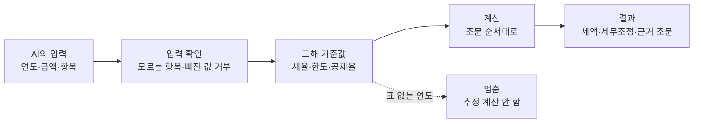

# korean-tax-calc-mcp — Korea Tax Calculator MCP (한국 세금 계산)

<!-- mcp-name: io.github.UpstageAI/korean-tax-calc-mcp -->


[](https://pypi.org/project/korean-tax-calc-mcp/) [](https://registry.modelcontextprotocol.io/v0/servers?search=korean-tax-calc-mcp) [](LICENSE) [](https://www.upstage.ai/) · [English](README-EN.md)

> **0.3.0부터 Solar Pro 4가 코드를 쓰고** CodeSolar가 리뷰, Claude가 테스트로 교차 검증합니다. **0.13.0의 점검·보완(연도별 조문·부칙 대조)은 Claude가 했습니다.** 도구 79개, 상세는 [CHANGELOG](CHANGELOG.md).

**Korean tax calculations for AI agents — code, not guesses.** [English](README-EN.md)

---

> 세금 계산은 AI가 자주 틀립니다. 이 서버는 계산을 코드로 하고, 결과마다 근거 조문을 붙입니다. 연도표가 없는 해는 추정하지 않고 멈춥니다.

## 작동 방식



1. **입력 확인** — 모르는 항목·빠진 값이 있으면 계산하지 않고 무엇이 필요한지 알려 줍니다.
2. **그해 기준값** — 세율·한도는 코드 안 연도표(법인세·소득세 2016~2026, 부가세 2016년 1기~2026년 2기), 항목별 판단 기준은 `facts_vocab.json`(적용 기간·근거 조문 포함)에서 꺼냅니다.
3. **계산** — 조문 순서대로 계산합니다. 예: 과세표준 → 그해 세율 구간 → 산출세액.
4. **결과** — 세액·중간 계산·항목별 판단·세무조정(소득처분)·근거 조문을 함께 돌려줍니다.

계산·판정 도구 73개는 생성형 AI 없이 내 PC에서 동작합니다. PDF 도구 3개만 `UPSTAGE_API_KEY`가 있을 때 Upstage를 씁니다.

## 이렇게 물어보세요

- "2025 사업연도 과세표준 5억 법인세 산출세액은?"
- "가지급금 3월 1일 2억 대여, 9월 30일 1억 회수 — 인정이자 계산해줘"
- "과소신고 1천만 원을 10월 7일에 납부하면 가산세는?"
- "퇴직금 1억, 근속 15년 퇴직소득세"
- "기업업무추진비 원장 5건 그대로 줄게 — 2025 사업연도 세무조정 뽑아줘"

## 설치

```bash
claude mcp add korean-tax-calc -- uvx korean-tax-calc-mcp
```

```json
{ "mcpServers": { "korean-tax-calc": { "command": "uvx", "args": ["korean-tax-calc-mcp"] } } }
```

새 버전으로 바로 바꾸려면 `uvx --refresh korean-tax-calc-mcp`(uvx는 받은 버전을 캐시합니다). 특정 버전 고정은 `uvx korean-tax-calc-mcp@0.13.0`.

키 없이 동작합니다. 선택: `LAW_OC`(세무조사 판정 도구 2개의 법제처 조문 조회), `UPSTAGE_API_KEY`(PDF 표 추출).
근거 조문·해석은 [korean-tax-mcp](https://github.com/UpstageAI/korean-tax-mcp)와 함께 쓰면 "근거 찾기 → 계산"이 이어집니다.

## 도구 (79개)

| 묶음 | 도구 |
|---|---|
| 법인세 (18) | 산출세액 `corporate_tax` · 외국납부세액공제 `foreign_tax_credit` · 기업업무추진비 한도 `entertainment_limit` · 가지급금 인정이자 `deemed_interest` · 부당행위 기준 `unfair_transaction` · 이월결손금 한도 `loss_carryforward_limit` · 최저한세 `minimum_tax` · 업무무관 지급이자(가지급금 제외 판정·적수·순위) `nonbusiness_interest_disallowance` · 업무용승용차 `business_car_expense` · 기부금 한도 `donation_limit` · 대손충당금 한도 `bad_debt_allowance` · 과소자본 `thin_capitalization` · 적격증빙 미수취 `missing_receipt_disallowance` · 수입배당금 익금불산입 `dividend_received_deduction` · 일시상각충당금 `asset_grant_reserve` · 임대보증금 간주익금 `corporate_deemed_rent_income` · 청산소득 `liquidation_income` · 재해손실세액공제 `disaster_loss_credit` |
| 소득세·원천·양도·상속증여 (17) | 종합소득세 `income_tax` · 원천징수 `withholding_tax` · 비거주자 원천징수 `nonresident_withholding` · 퇴직소득세 `retirement_income_tax` · 근로소득세 `wage_income_tax` · 일용근로자 `daily_worker_withholding` · 소득처분 상여 재정산 `deemed_bonus_resettlement` · 특별세액공제 `special_tax_credit` · 양도소득 `capital_gains_income` · 상속세 `inheritance_tax` · 증여세 `gift_tax` · 추계 사업소득 `estimated_business_income` · 인적공제 `personal_deduction` · 연금소득금액 `pension_income` · 결손금 공제 `income_loss_offset` · 연금계좌 인출 `pension_account_withdrawal` · 상속·증여재산 평가 `inheritance_gift_valuation` |
| 부가세·가산세·제척기간 (13) | 간주임대료 `vat_deemed_rent` · 의제매입세액 `vat_deemed_input_credit` · 공통매입세액 안분 `vat_common_input_allocation` · 간이과세 납부세액 `vat_simplified_taxpayer` · 카드 발행세액공제 `vat_card_sales_credit` · 대손세액공제 `vat_bad_debt_credit` · 과소신고가산세 `underreporting_penalty` · 납부지연가산세 `late_payment_penalty` · 세금계산서 가산세 `invoice_penalty` · 부과제척기간 `assessment_limitation` · 면세전용 간주공급 `vat_exempt_use_deemed_supply` · 매입세액 공제 판정 `vat_input_tax_deduction` · 간주공급 판정 `vat_deemed_supply_items` |
| 사실관계·원장 → 세무조정 (15) | 대손 조정 `bad_debt_adjustment` · 기업업무추진비 조정 `entertainment_adjustment` · 무상주 의제배당 `deemed_dividend_bonus_shares` · 금융소득 합산 `financial_income_aggregate` · 기타소득 `other_income_aggregate` · 근로소득 총급여 `earned_income_gross_pay` · 간이과세 확정신고 `simplified_vat_return` · 공통매입세액 정산 `common_input_tax` · 매입세액 재계산 `input_tax_recalculation` · 토지·건물 안분 `bundled_supply_split` · 감가상각 시부인 `depreciation_adjustment` · 퇴직급여충당금 `retirement_allowance_adjustment` · 감자 의제배당 `deemed_dividend_capital_reduction` · 재고자산 평가 `inventory_valuation_adjustment` · 차가감소득금액 `income_adjustment_total` |
| 세무조사 판정 (9) | 특수관계 `related_judge` · 친족관계 `kinship_check` · 간접보유비율 `ownership_ratio` · 지배주주 `dominant_shareholder` · 일감몰아주기 `tunnelling_gift` · 일감몰아주기(국세청 산식) `tunnelling_gift_nts` · 특수관계 조문 위치 `related_provision_at` · 신고서 사전검토 `return_precheck` · 사전검토 입력 목록 `precheck_schema` |
| PDF 표 추출 (3) | 관계표 `extract_relations` · 일감몰아주기 자료 `tunnelling_from_pdf` · 법인세 신고서 `return_precheck_pdf` |
| 엑셀 내보내기 (1) | 계산 근거 엑셀 `export_workbook` |

- **계산 근거 엑셀**: `export_workbook`은 여러 도구 호출을 다시 실행해 법정서식 모양(별지 제3호·제15호·제23호(갑)(을)·제20호(1)·제16호의2·제50호(을), 부가세 공제받지 못할 매입세액 명세서, 종합소득세 부속 명세서 등)의 검토용 엑셀로 냅니다. 금액 칸은 서식 산식 그대로의 수식이고 서식끼리 연결되며, 도구 값과 대조하는 확인 칸이 붙습니다. 계산 과정을 보여 주는 참고 자료이며 세무조정계산서 작성·신고 대리가 아닙니다.
- **원장 그대로 입력**: 세무조정 도구는 장부 항목(이름·금액·증빙·성격)을 그대로 받아 항목 판단 → 세무조정 → 소득처분까지 돌려줍니다.
- **쟁점 표시**: 비거주자 원천징수·과소자본 결과에는 다툼이 될 수 있는 지점과 확인할 자료를 함께 붙입니다(결론은 내리지 않음).
- **지원 연도**: 법인세 2016~2026 사업연도, 소득세 2016~2026 귀속연도, 부가가치세 2016년 1기~2026년 2기, 가산세·제척기간은 현행 조문. 그 밖의 연도는 오류로 멈춥니다. 지방소득세는 별도입니다.

## 면책 및 고지

- **면책:** 이 도구의 결과는 세무 자문이 아닙니다. 법령·해석을 바탕으로 계산·판정 과정을 보여 주는 참고 자료이며, 실제 신고·세무조사·불복 판단은 세무사·회계사·변호사 등 전문가에게 확인하세요. 근거 조문·판례는 원문으로 확인하세요.
- **세무대리 아님:** 이 도구는 **세무사법 제2조의 세무대리**(세무조정계산서 작성, 신고 대리, 세무상담 등)를 수행하지 않으며, 그 업무는 세무사와 등록한 공인회계사·변호사만 할 수 있습니다(세무사법 제20조). 법령에 적힌 산식을 코드로 옮겨 입력값에 대한 계산 과정을 보여 주는 소프트웨어이고, 입력 사실관계의 확인과 최종 판단은 세무 전문가(세무사·회계사·변호사)와 함께 해 주세요.
- **AI 사용 고지:** 계산·판정 도구 73개는 코드로 동작하며 생성형 AI를 쓰지 않습니다. PDF 검토 도구 3개(`extract_relations`, `tunnelling_from_pdf`, `return_precheck_pdf`)는 UPSTAGE_API_KEY가 있으면 생성형 AI(Upstage Solar Pro 4)로 표를 추출하며 결과에 그 사실을 표시합니다. 키가 없으면 pypdf로 로컬 텍스트 추출(host_ai 모드) 후 정리 안내에 따라 다음 도구 입력으로 직접 정리할 수 있습니다.
- **데이터 전송:** UPSTAGE_API_KEY를 설정해 PDF 도구를 사용할 때만 문서 내용이 Upstage API(api.upstage.ai)로 전송됩니다. 키 없이 사용하면(pypdf 로컬 추출) 외부 전송이 없습니다. 민감정보가 담긴 문서는 API 전송 시 넣지 마세요.

## 라이선스

MIT © 2026 Upstage · Created by Mia(윤승미)
