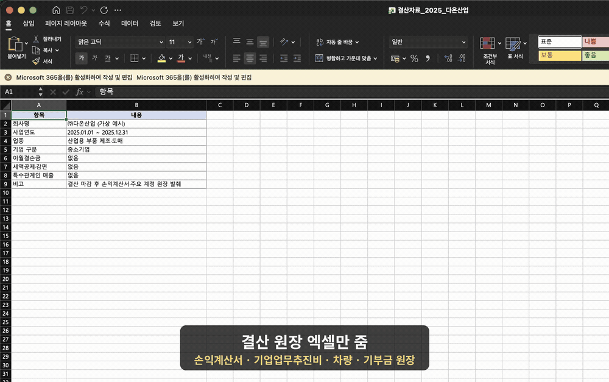
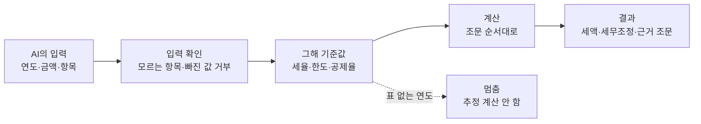
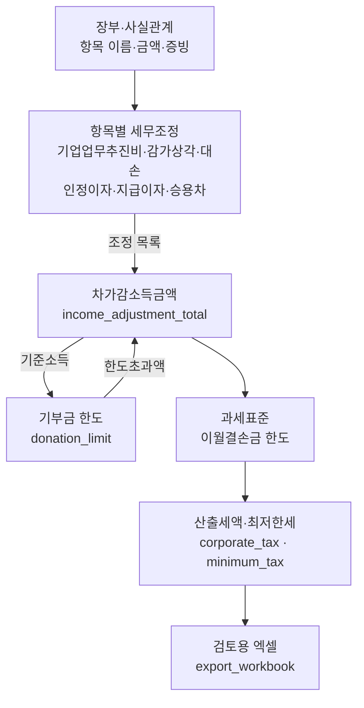

# korean-tax-calc-mcp — Korea Tax Calculator MCP (한국 세금 계산)

<!-- mcp-name: io.github.UpstageAI/korean-tax-calc-mcp -->



[](https://pypi.org/project/korean-tax-calc-mcp/) [](https://registry.modelcontextprotocol.io/v0/servers?search=korean-tax-calc-mcp) [](LICENSE) [](https://www.upstage.ai/) · [English](README-EN.md)

> **작성 주체(정확한 고지):** 0.3.0~0.12.2(2026-10-10~10-26)는 **Solar Pro 4**(Solar Work CLI)가 코드를 쓰고 CodeSolar가 리뷰, Claude가 테스트로 교차 검증했습니다(0.8.0 일부 문법 오류와 0.9.2는 Claude가 수정·작성). **0.13.0(2026-10-28)부터는 기존 계산기 뼈대는 Solar Pro 4 그대로이고, 새 도구·연도별 조문 대조·버그 수정은 Claude(Anthropic)가 작성**하며 CodeSolar가 리뷰합니다. 버전별 작성 주체는 [CHANGELOG](CHANGELOG.md) 각 절 머리에 적혀 있습니다. 도구 94개.

**Korean tax calculations for AI agents — code, not guesses.** [English](README-EN.md)

---

> 세금 계산은 AI가 자주 틀립니다. 이 서버는 계산을 코드로 하고, 결과마다 근거 조문을 붙입니다. 연도표가 없는 해는 추정하지 않고 멈춥니다.

## 작동 방식



1. **입력 확인** — 모르는 항목·빠진 값이 있으면 계산하지 않고 무엇이 필요한지 알려 줍니다.
2. **그해 기준값** — 세율·한도는 코드 안 연도표(법인세·소득세 2016~2026, 부가세 2016년 1기~2026년 2기), 항목별 판단 기준은 `facts_vocab.json`(적용 기간·근거 조문 포함)에서 꺼냅니다.
3. **계산** — 조문 순서대로 계산합니다. 예: 과세표준 → 그해 세율 구간 → 산출세액.
4. **결과** — 세액·중간 계산·항목별 판단·세무조정(소득처분)·근거 조문을 함께 돌려줍니다.

도구 94개 중 91개는 생성형 AI 없이 코드로 동작합니다(시세·공시가격 조회 2개는 KRX·브이월드 공개 데이터만 가져옵니다). PDF 도구 3개만 `UPSTAGE_API_KEY`가 있을 때 Upstage를 씁니다.

### 법인세 세무조정이 이어지는 모양

도구는 하나씩도 쓰지만, 법인세는 앞 도구의 결과가 다음 도구의 입력이 되도록 이어집니다.



항목별 조정 도구는 소득처분(유보·상여·기타사외유출 등)까지 돌려주고, `export_workbook`은 같은 호출을 다시 실행해 별지 서식끼리 수식으로 연결된 엑셀을 만듭니다. 어떤 도구를 쓸지 모르면 `find_tool`에 평소 말로 물어보면 됩니다.

## 이렇게 물어보세요

- "2025 사업연도 과세표준 5억 법인세 산출세액은?"
- "가지급금 3월 1일 2억 대여, 9월 30일 1억 회수 — 인정이자 계산해줘"
- "과소신고 1천만 원을 10월 7일에 납부하면 가산세는?"
- "퇴직금 1억, 근속 15년 퇴직소득세"
- "기업업무추진비 원장 5건 그대로 줄게 — 2025 사업연도 세무조정 뽑아줘"

## 설치

```bash
claude mcp add korean-tax-calc -- uvx korean-tax-calc-mcp
```

```json
{
  "mcpServers": {
    "korean-tax-calc": { "command": "uvx", "args": ["korean-tax-calc-mcp"] },
    "korean-tax":      { "command": "uvx", "args": ["korean-tax-mcp"], "env": { "LAW_OC": "법제처 OC(무료, 선택)" } }
  }
}
```

두 번째 줄의 [korean-tax-mcp](https://github.com/UpstageAI/korean-tax-mcp)는 조문·부칙·해석·판례를 찾는 짝 서버입니다. 같이 두면 **근거 찾기 → 계산 → 서식**이 한 대화에서 이어지고, 이 서버의 `find_tool`도 계산 도구가 없는 질문(월세·연금계좌 세액공제, 주식 양도 등)에 바로 부를 조문 호출값을 돌려줍니다. 계산만 쓰려면 첫 줄만 넣어도 됩니다.

새 버전으로 바로 바꾸려면 `uvx --refresh korean-tax-calc-mcp`(uvx는 받은 버전을 캐시합니다). 특정 버전 고정은 `uvx korean-tax-calc-mcp@0.19.1`.

키 없이 동작합니다. 선택: `LAW_OC`(세무조사 판정 도구 2개의 법제처 조문 조회), `UPSTAGE_API_KEY`(PDF 표 추출).

## 함께 쓰면 좋은 지침

AI가 도구를 언제 부르고, 도구의 답을 언제 믿을지 정해 주는 다섯 줄입니다. 서버 안내문(instructions)에도 같은 규칙이 들어 있지만, 클라이언트에 따라 안내문을 약하게 반영하거나 읽지 않습니다. 아래를 시스템 프롬프트에 넣으면 더 잘 지킵니다(Claude Desktop 프로젝트 지침, Claude Code의 `CLAUDE.md`, 그 밖의 맞춤 지침).

```text
세금 질문에 답할 때 korean-tax-mcp와 korean-tax-calc-mcp를 이렇게 쓴다.
1. 숫자 하나, 판단 하나마다 쓸 수 있는 도구가 있는지 먼저 찾는다. 이름을 모르면 find_tool로 찾고, 귀속·공급시기는 timing_rules를 먼저 본다.
2. 도구가 있으면 손으로 풀기 전에 도구부터 부른다.
3. 도구의 답과 내 계산이 다르면 바로 고르지 않는다. 입력을 다시 확인하고, 차이를 가르는 조문을 law_article로 열어 요건을 사실관계에 하나씩 맞춰 본다.
4. 조문에서 도구가 틀렸다는 근거를 못 찾으면 도구의 답을 따른다. 다른 값을 쓰면 그 이유(입력 오류 또는 조문 번호)를 한 줄 적는다.
5. 답이 두 개 나오면(안분 전후, 전체와 과세분 등) 질문이 묻는 하나만 답한다.
```

## 도구 (94개)

묶음 이름을 누르면 도구 목록이 펼쳐집니다.

<details>
<summary><b>법인세</b> (18)</summary>

| 도구 | 하는 일 |
|---|---|
| `corporate_tax` | 산출세액 |
| `foreign_tax_credit` | 외국납부세액공제 |
| `entertainment_limit` | 기업업무추진비 한도 |
| `deemed_interest` | 가지급금 인정이자 |
| `unfair_transaction` | 부당행위 기준 |
| `loss_carryforward_limit` | 이월결손금 한도 |
| `minimum_tax` | 최저한세 |
| `nonbusiness_interest_disallowance` | 업무무관 지급이자(가지급금 제외 판정·적수·순위) |
| `business_car_expense` | 업무용승용차 |
| `donation_limit` | 기부금 한도 |
| `bad_debt_allowance` | 대손충당금 한도 |
| `thin_capitalization` | 과소자본 |
| `missing_receipt_disallowance` | 적격증빙 미수취 |
| `dividend_received_deduction` | 수입배당금 익금불산입 |
| `asset_grant_reserve` | 일시상각충당금 |
| `corporate_deemed_rent_income` | 임대보증금 간주익금 |
| `liquidation_income` | 청산소득 |
| `disaster_loss_credit` | 재해손실세액공제 |

</details>
<details>
<summary><b>소득세·원천·양도·상속증여</b> (24)</summary>

| 도구 | 하는 일 |
|---|---|
| `income_tax` | 종합소득세 |
| `withholding_tax` | 원천징수 |
| `nonresident_withholding` | 비거주자 원천징수 |
| `retirement_income_tax` | 퇴직소득세 |
| `wage_income_tax` | 근로소득세 |
| `daily_worker_withholding` | 일용근로자 |
| `deemed_bonus_resettlement` | 소득처분 상여 재정산 |
| `special_tax_credit` | 특별세액공제 |
| `capital_gains_income` | 양도소득 |
| `inheritance_tax` | 상속세 |
| `gift_tax` | 증여세 |
| `estimated_business_income` | 추계 사업소득 |
| `personal_deduction` | 인적공제 |
| `pension_income` | 연금소득금액 |
| `income_loss_offset` | 결손금 공제 |
| `pension_account_withdrawal` | 연금계좌 인출 |
| `inheritance_gift_valuation` | 상속·증여재산 평가 |
| `capital_gains_tax` | 양도소득 산출세액 |
| `housing_deemed_rent_income` | 주택 간주임대료 |
| `housing_rental_income` | 주택임대소득(비과세·분리과세) |
| `child_tax_credit` | 자녀세액공제 |
| `dividend_tax_credit` | 배당세액공제(비교산출세액) |
| `religious_income` | 종교인소득 |
| `individual_donation_expense` | 개인사업자 기부금 필요경비 한도 |

</details>
<details>
<summary><b>부가세·가산세·제척기간</b> (15)</summary>

| 도구 | 하는 일 |
|---|---|
| `vat_deemed_rent` | 간주임대료 |
| `vat_deemed_input_credit` | 의제매입세액 |
| `vat_common_input_allocation` | 공통매입세액 안분 |
| `vat_simplified_taxpayer` | 간이과세 납부세액 |
| `vat_card_sales_credit` | 카드 발행세액공제 |
| `vat_bad_debt_credit` | 대손세액공제 |
| `underreporting_penalty` | 과소신고가산세 |
| `late_payment_penalty` | 납부지연가산세 |
| `withholding_late_payment_penalty` | 원천징수 납부지연가산세(국세기본법 제47조의5, 3%+일할, 한도) |
| `invoice_penalty` | 세금계산서 가산세 |
| `assessment_limitation` | 부과제척기간 |
| `vat_exempt_use_deemed_supply` | 면세전용 간주공급 |
| `vat_input_tax_deduction` | 매입세액 공제 판정 |
| `vat_deemed_supply_items` | 간주공급 판정 |
| `vat_supply_timing` | 공급시기 판정(예정·확정 귀속) |

</details>
<details>
<summary><b>사실관계·원장 → 세무조정</b> (15)</summary>

| 도구 | 하는 일 |
|---|---|
| `bad_debt_adjustment` | 대손 조정 |
| `entertainment_adjustment` | 기업업무추진비 조정 |
| `deemed_dividend_bonus_shares` | 무상주 의제배당 |
| `financial_income_aggregate` | 금융소득 합산 |
| `other_income_aggregate` | 기타소득 |
| `earned_income_gross_pay` | 근로소득 총급여 |
| `simplified_vat_return` | 간이과세 확정신고 |
| `common_input_tax` | 공통매입세액 정산 |
| `input_tax_recalculation` | 매입세액 재계산 |
| `bundled_supply_split` | 토지·건물 안분 |
| `depreciation_adjustment` | 감가상각 시부인 |
| `retirement_allowance_adjustment` | 퇴직급여충당금 |
| `deemed_dividend_capital_reduction` | 감자 의제배당 |
| `inventory_valuation_adjustment` | 재고자산 평가 |
| `income_adjustment_total` | 차가감소득금액 |

</details>
<details>
<summary><b>주식·재산 평가</b> (7)</summary>

| 도구 | 하는 일 |
|---|---|
| `stock_major_shareholder` | 주식 양도세 대주주 판정(주주 명부로 지분율·합산 범위까지) |
| `stock_capital_gains_tax` | 주식 양도소득세(과세 대상 여부·세율·예정신고기한) |
| `unlisted_stock_valuation` | 비상장주식 상속·증여 평가(순손익·순자산 가중평균, 할증) |
| `stock_basis_income_tax` | 비상장주식 소득세법 기준시가 |
| `building_standard_price` | 건물 기준시가(국세청 고시 산식) |
| `stock_price_lookup` | 상장주식 시세 조회(KRX) |
| `official_property_price` | 부동산 공시가격 조회(브이월드, VWORLD_KEY) |

</details>
<details>
<summary><b>세무조사 판정</b> (9)</summary>

| 도구 | 하는 일 |
|---|---|
| `related_judge` | 특수관계(생계를 함께하는 친족 포함) |
| `kinship_check` | 친족관계 |
| `ownership_ratio` | 간접보유비율 |
| `dominant_shareholder` | 지배주주 |
| `tunnelling_gift` | 일감몰아주기 |
| `tunnelling_gift_nts` | 일감몰아주기(국세청 산식) |
| `related_provision_at` | 특수관계 조문 위치 |
| `return_precheck` | 신고서 사전검토 |
| `precheck_schema` | 사전검토 입력 목록 |

</details>
<details>
<summary><b>PDF 표 추출</b> (3)</summary>

| 도구 | 하는 일 |
|---|---|
| `extract_relations` | 관계표 |
| `tunnelling_from_pdf` | 일감몰아주기 자료 |
| `return_precheck_pdf` | 법인세 신고서 |

</details>
<details>
<summary><b>국세징수</b> (1)</summary>

| 도구 | 하는 일 |
|---|---|
| `tax_priority_distribution` | 국세 우선권 매각대금 배분 |

</details>
<details>
<summary><b>엑셀 내보내기</b> (1)</summary>

| 도구 | 하는 일 |
|---|---|
| `export_workbook` | 계산 근거 엑셀 |

</details>
<details>
<summary><b>도구 찾기</b> (1)</summary>

| 도구 | 하는 일 |
|---|---|
| `find_tool` | 평소 말로 맞는 도구 찾기 |

</details>

- **계산 근거 엑셀**: `export_workbook`은 여러 도구 호출을 다시 실행해 법정서식 모양(별지 제3호·제15호·제23호(갑)(을)·제34호·제20호(1)·제16호의2·제26호(갑)(을)·제50호(을), 부가세 공제받지 못할 매입세액 명세서, 종합소득세 부속 명세서, 양도소득세 별지 제84호 신고서 세액 계산·부표1 양도소득금액 계산명세서 등)의 검토용 엑셀로 만듭니다. 금액 칸은 서식 산식 그대로의 수식이고 서식끼리 연결되며, 도구 값과 대조하는 확인 칸이 붙습니다. 계산 과정을 보여 주는 참고 자료이며 세무조정계산서 작성·신고 대리가 아닙니다.
- **원장 그대로 입력**: 세무조정 도구는 장부 항목(이름·금액·증빙·성격)을 그대로 받아 항목 판단 → 세무조정 → 소득처분까지 돌려줍니다.
- **쟁점 표시**: 비거주자 원천징수·과소자본 결과에는 다툼이 될 수 있는 지점과 확인할 자료를 함께 붙입니다(결론은 내리지 않음).
- **지원 연도**: 법인세 2016~2026 사업연도, 소득세 2016~2026 귀속연도, 부가가치세 2016년 1기~2026년 2기, 가산세·제척기간은 현행 조문. 그 밖의 연도는 오류로 멈춥니다. 지방소득세는 별도입니다.

## 면책 및 고지

- **면책:** 이 도구의 결과는 세무 자문이 아닙니다. 법령·해석을 바탕으로 계산·판정 과정을 보여 주는 참고 자료이며, 실제 신고·세무조사·불복 판단은 세무사·회계사·변호사 등 전문가에게 확인하세요. 근거 조문·판례는 원문으로 확인하세요.
- **세무대리 아님:** 이 도구는 **세무사법 제2조의 세무대리**(세무조정계산서 작성, 신고 대리, 세무상담 등)를 수행하지 않으며, 그 업무는 세무사와 등록한 공인회계사·변호사만 할 수 있습니다(세무사법 제20조). 법령에 적힌 산식을 코드로 옮겨 입력값에 대한 계산 과정을 보여 주는 소프트웨어이고, 입력 사실관계의 확인과 최종 판단은 세무 전문가(세무사·회계사·변호사)와 함께 해 주세요.
- **AI 사용 고지:** 계산·판정·조회 도구 91개는 코드로 동작하며 생성형 AI를 쓰지 않습니다. PDF 검토 도구 3개(`extract_relations`, `tunnelling_from_pdf`, `return_precheck_pdf`)는 UPSTAGE_API_KEY가 있으면 생성형 AI(Upstage Solar Pro 4)로 표를 추출하며 결과에 그 사실을 표시합니다. 키가 없으면 pypdf로 로컬 텍스트 추출(host_ai 모드) 후 정리 안내에 따라 다음 도구 입력으로 직접 정리할 수 있습니다.
- **데이터 전송:** UPSTAGE_API_KEY를 설정해 PDF 도구를 사용할 때만 문서 내용이 Upstage API(api.upstage.ai)로 전송됩니다. 시세 조회(`stock_price_lookup`)는 KRX로 종목코드·날짜를, 공시가격 조회(`official_property_price`, VWORLD_KEY 필요)는 브이월드로 주소·필지번호·연도를 보냅니다. 키 없이 사용하면(pypdf 로컬 추출) 외부 전송이 없습니다. 민감정보가 담긴 문서는 API 전송 시 넣지 마세요.

## 라이선스

MIT © 2026 Upstage · Created by Mia(윤승미)
